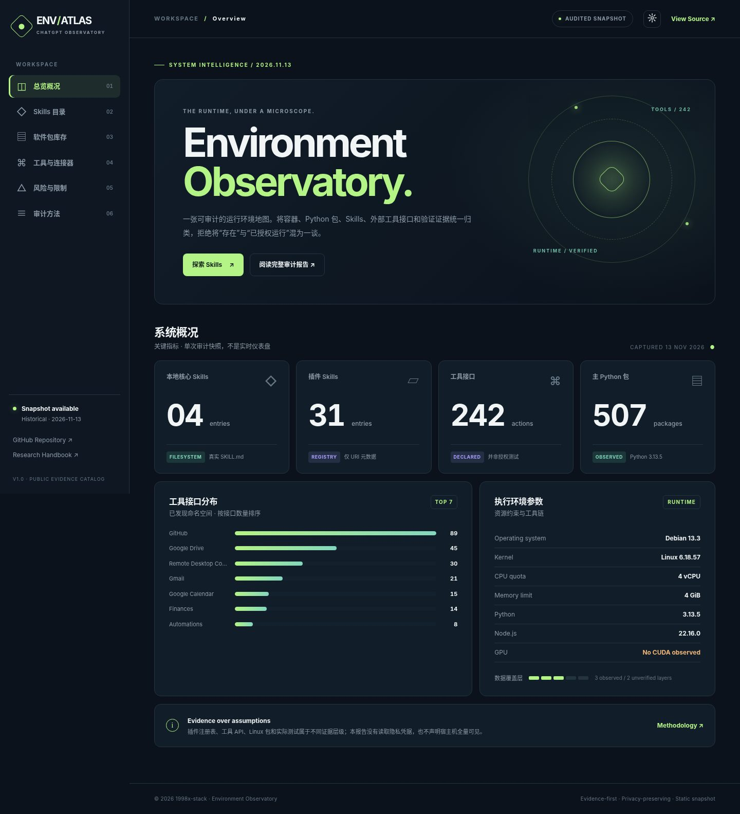

# ChatGPT Env Analysis

**可复核的 ChatGPT 执行环境审计 · Skills Registry · Runtime Inventory · Visual Dashboard**

[在线可视化仪表盘](https://1998x-stack.github.io/ChatGPT-env-analysis/) · [审计快照](reports/2026-11-13/original-audit.md) · [分类数据](data/catalog) · [使用手册](handbook/README.md) · [原生审计 Skills](skills) · [部署与迁移](handbook/operations/migration.md)

> **2026-11-13 静态快照，非实时接口。** 该项目审计的是本会话可访问的 Linux 容器和工具清单，不是 OpenAI 宿主机、账户全部权限或一个所有 ChatGPT 用户通用的固定配置。网页部署需要仓库 Pages 权限及 GitHub Actions 运行成功。



## 环境概览

| 环境指标 | 数据 | 证据边界 |
|---|---:|---|
| 本地注册核心 Skills | 4 | `/home/oai/skills/*/SKILL.md` |
| 插件注册表 Skill URI | 31 | 插件目录（非磁盘安装） |
| Typer 包携带 Skill | 1 | 随包文件，**非已注册** |
| 动态工具接口 | 242 | 会话工具接口目录，**非逐项授权验证** |
| 主 Python pip 包 | 507 | Python 3.13.5 主环境 |
| 第二/终端/系统 Python 包 | 124 / 14 / 34 | 相互隔离的解释器 |
| Debian 软件包 | 1,398 | dpkg 快照 |
| npm 全局包 | 22 | npm global dependency tree |
| 可执行命令 | 2,101 | PATH 枚举（并非所有可执行文件） |
| 物理 GPU | 未见可访问设备 | 仅说明当时容器不可用 CUDA |
| CPU / RAM | 4 CPU 配额 / 4 GiB cgroup | 容器限额，非物理主机总量 |

## 项目结构

```text
ChatGPT-env-analysis/
├── README.md · AGENTS.md · LICENSE
├── .github/workflows/         # CI + Pages 发布
├── skills/
│   ├── runtime-audit/         # 原创安全环境采集器
│   ├── skill-inventory/       # 本地/插件 Skills 分层枚举
│   └── environment-diff/      # 环境快照差异检测
├── handbook/
│   ├── inventory/             # OS/Python/Skills/Tools/测试
│   ├── operations/            # 复跑/迁移/Pages 部署
│   └── governance/            # 来源、版权、安全与数据字典
├── data/
│   ├── catalog/               # 分类 CSV / TSV / JSON
│   └── snapshots/2026-11-13/ # 允许公开的验证快照
├── reports/2026-11-13/       # 中文完整历史审计报告
├── documents/                # Executive summary PDF / DOCX
├── spreadsheets/             # XLSX 多工作表审计台账
├── docs/                     # 零构建 GitHub Pages 前端
├── scripts/                  # 数据集生成器
└── tests/                    # stdlib 回归测试
```

## 为什么不用一个 `requirements.txt` 复制所有包？

四套 Python 环境、Debian 依赖及 Node 全局包彼此独立。把这些包强行合并不仅可能失败，还可能破坏共享运行环境。此仓库保存 **inventory / provenance / smoke test / compatibility**，并提供新环境中的安全只读采集，而非自动执行全局安装。

## 快速开始

```bash
# 无需外部依赖，读取当前机器的允许公开信息
python skills/runtime-audit/scripts/audit_runtime.py --output /tmp/env-snapshot.json

# 合并本地 Skills 路径和静态插件注册表 URI
python skills/skill-inventory/scripts/catalog_skills.py \
  --local-root /home/oai/skills \
  --registry data/catalog/plugin-skill-registry.tsv \
  --output /tmp/skills.json

# 环境漂移检测（返回 2 代表发现差异）
python skills/environment-diff/scripts/compare_snapshots.py old.json new.json

# 本地预览 Pages
python -m http.server 8000 --directory docs
# 打开 http://localhost:8000

# 静态校验
python -m unittest discover -s tests -v
```

## 三种事实，不要混淆

- **Installed / Observed**：文件或包实际存在。`import` 和运行测试是更高一级的证据。
- **Advertised / Declared**：插件注册表或工具目录展示了能力；不代表连接授权完成。
- **Deployable / Public**：提交网站源码只是准备好发布；实际 Pages URL 必须由成功的 Actions 部署或 Pages 设置验证。

## 已识别的现实限制

- `moviepy 2.2.1` 与 `Pillow 12.3.0` 版本约束冲突；系统 Python Supervisor 缺少 `setuptools`。
- 容器外网 DNS 检查失败；不能因此断定所有平台连接器均不可用。
- Playwright Chromium 启动与 `set_content()` 已验证，直接 `data:` 导航被策略阻止。
- 不可访问 CUDA GPU，4 GiB 内存限制影响本地大型模型部署。

详细证据：[质量与限制](handbook/inventory/quality.md) / [安全发布](handbook/governance/publication-safety.md)。

## 版权与公开边界

本仓库的 `skills/` 是**原创工作流和代码**。平台内置的 4 个核心 Skill、31 个插件 Skill 和第三方 Typer Skill 仅以名称、URI、分类、来源和公开许可状态记录；**不镜像其原始源文件**。如你有权迁移这些文件，请按照 [手工迁移与本地 ZIP 指南](handbook/operations/migration.md) 在你的机器上完成。公开代码采用 MIT License，第三方文件原版权不受此许可覆盖。

## 更新策略

静态快照通过文件日期版本化；变化需附 `schema_version`、采集来源、失败结果和校验。请勿自动抓取账号私有数据或通过 Pages 暴露运行时环境变量。见 [AGENTS.md](AGENTS.md) 与 [Roadmap](handbook/roadmap.md)。
