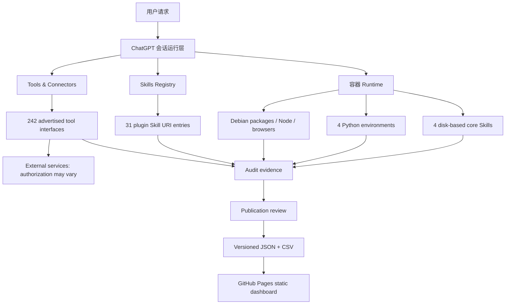

# 三层架构：可访问 ≠ 已安装 ≠ 已授权

- **本地容器**：可以观察和测试依赖、文件、命令、CPU 限额。不能等同于整个宿主机。
- **Skills Registry**：某些 Skill 仅作为 URI、可调用描述存在，不等于 `/home/oai/skills` 下的磁盘文件。
- **工具连接器**：功能接口表只说明平台暴露了某个 action；服务授权、额度、实际读写都需要独立核查。
- **发布**：网页只是某个日期的脱敏静态快照。不能承诺永远实时反映当前容器。

## 证据链

`采集方式 → 原始结果 → 规范化行 → 计数校验 → 限制声明 → 网页呈现`。错误必须保留；公开展示未知项为未知，而不是直接标成失败或成功。
